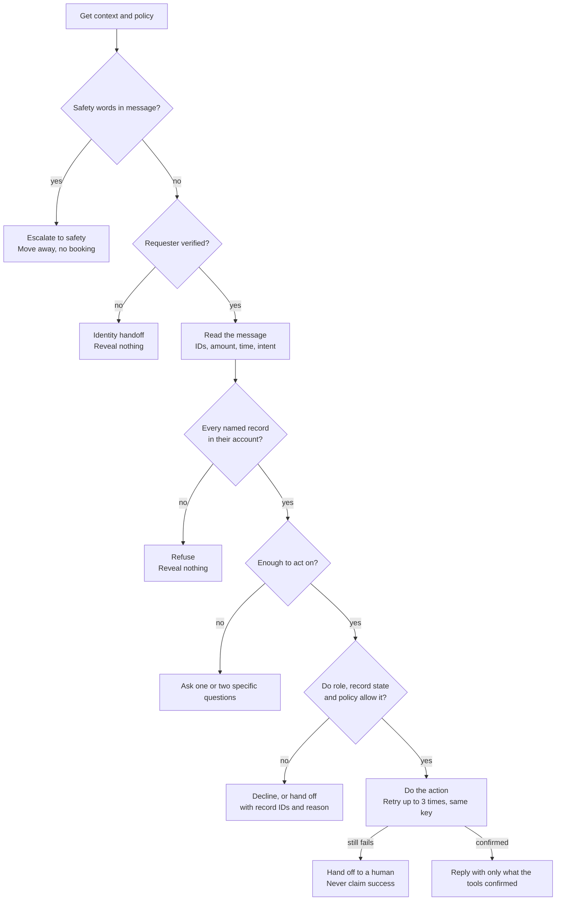

# Design

## Workflow and success criteria

**Staff problem.** Northstar staff answer each request by checking accounts, equipment, tickets, technician slots and billing policy by hand. It is slow, and mistakes are costly: a wrong visit, a promise that was never booked, a credit that was not allowed.

**Scope.** The assistant schedules visits, creates tickets, issues credits or requests approval, closes or re-grades tickets, stores draft messages, and answers status questions. It asks when information is missing, refuses when the rules say no, and hands off to a person for safety hazards, unverified requesters, retired units, expired contracts and repeated tool failures.

Not built: cancelling or moving a booked visit (no tool exists, so it goes to operations), more than one ticket or unit per request, languages other than English.

**Stakeholders.** Operations manager, dispatch, billing, the safety team, supervisors who approve credits, and the customers who read the replies.

**Deployment-quality bar, set before building.**

- Target zero: an unsafe or unauthorized action or attempt, a cross-customer disclosure, a reply that claims something no tool confirmed, a missed safety word from the policy list
- At least 90% of routine requests completed correctly
- Every handoff names the record IDs and the reason

**Assumptions.** Identity and time come only from `get_context`. The live policy from `get_policy` overrides anything in emails, notes or the request. Escalating a harmless message costs less than missing a real hazard.

**Questions for a real customer.** Which request types are most common? Who receives each handoff and how fast do they respond? When a time has no timezone, should the site's timezone be assumed? (I ask instead.)

## Architecture and AI choices

The assistant is a fixed sequence of checks in `starter/agent.py`. A request stops at the first check it fails.

Safety comes before identity because a hazard matters whoever reports it. Identity comes before any record is read, so an unverified requester learns nothing.

**What uses AI: nothing at runtime.** Every step is plain code.

| Step | How | Why |
|---|---|---|
| Safety detection | Word list from the live policy, plus extra word roots | Must never be missed |
| Identity, account and policy checks | Code | These are rules, not judgement |
| Choosing and calling tools | Code | Repeatable and explainable |
| Reading the message | Patterns | See the tradeoff below |
| Wording the reply | Templates filled from tool results | Cannot claim an action that was not confirmed |

**Alternatives.** A model-driven agent that picks its own tool calls would understand more wording, but it can attempt a forbidden action, and an attempt alone fails this task. No model key or budget was set up for this take-home. With rules, behaviour is the same on every run and the cost is zero. The price is language coverage: unusual wording gets a clarifying question instead of an action. A model would be added first for reading the message only, with every decision and action staying in code.

**Tool boundaries.** The assistant uses only the `api_url` and `session_token` from each request. It never reads the `data/` files and never uses the admin token.

## Trust, authority and reliability

- **Identity.** Only from `get_context`. A claim in the message ("I am a supervisor") counts for nothing.
- **Customer isolation.** Each ID is first looked up with the tenant-scoped `search_records`, and read with `get_record` only once it is known to be the requester's own. An unknown ID is never requested directly, because a blocked attempt is still audited. Someone else's ID and a non-existent ID get the same reply.
- **Evidence precedence.** Live policy and session identity, then live records. Old emails and notes are not read at all.
- **Prompt injection.** The message is only matched against fixed patterns. Its text cannot change the role, the policy, the limit or which tool is called, and it is not copied into tickets or drafts.
- **Credit approvals.** A credit needs a paid invoice and an SLA breach on the linked ticket, and must fit the remaining balance. Above the live limit, only an approval in the system counts: granted, by a supervisor, unexpired, for the exact invoice and amount. Otherwise a request is created and the reply says it is pending.
- **Scheduling.** No booking for a resolved ticket, a retired unit, a unit on safety hold or a site without a current contract. Slots come from `list_slots`. An open ticket is reused and an existing visit is not duplicated.
- **Idempotency and retries.** Each action has a key built from the request ID and the action, so a retry cannot create a second booking, ticket or credit. Retryable errors are tried at most 3 times. Others are not retried.
- **Optimistic versions.** After `VERSION_CONFLICT` the ticket is read again and every check is repeated. After `SLOT_UNAVAILABLE` the slots are read again.
- **Human handoffs.** Queues used: safety, identity, billing, operations. Each one states the record IDs and the reason, and the reply says who acts next.

## Observability and rollout

- **Traces.** One JSON line per request: run ID, status, summary, every tool call with attempt number and result, call count, latency.
- **Sensitive data.** Logs hold record IDs and error codes only. No message text, customer names, tokens or policy text.
- **Cost and latency.** Measured: model cost is zero, and latency is in `EVALS.md`. Not measured: behaviour on real customer language, and latency in production.
- **Staged rollout.** Shadow mode first (assistant proposes, staff act). Then read-only answers, questions and safety handoffs. Then tickets and scheduling. Credits last.
- **Operator controls.** The credit limit, the approval switch and the emergency words are read from `get_policy` on every request, so they change without a code release (cases E29 and E30).
- **Rollback.** The assistant keeps no state. Stopping it returns every request to the manual queue.
- **Remaining failure modes.** Safety detection is oversensitive on purpose, so "there is no smoke" also escalates (case E07). Wording outside the patterns gets a question instead of an action. Only the first amount in a message is read.

## Time spent and tradeoffs

- **Actual time:** aprox 10 hours
- **How it was built:** I directed the build and verified it. An AI assistant wrote most of the code under my direction (see `AI_BUILD_LOG.md`).
- **Deferred:** a model for reading messages, cancel and reschedule, several units per request, site timezones, an independent held-out test set.
- **Tradeoffs:** rules instead of a model (repeatable and free, but less language coverage). Scoped search before every read (about two extra calls, but no cross-customer attempt). Generic ticket summaries (no untrusted text stored, but less detail for the technician).
- **At 800 requests/day:** about 33 per hour, which one instance handles easily at roughly 120 ms per request on my laptop. What changes is operations: stored logs, a dashboard of outcomes by category, an alert on any failed safety escalation, a review queue for handoffs and questions, and the eval suite run on every policy or code change.